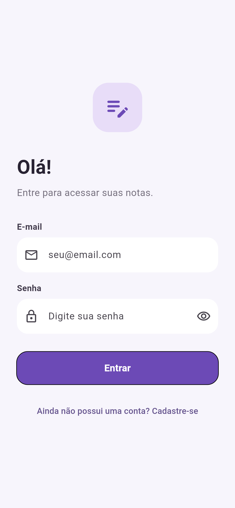
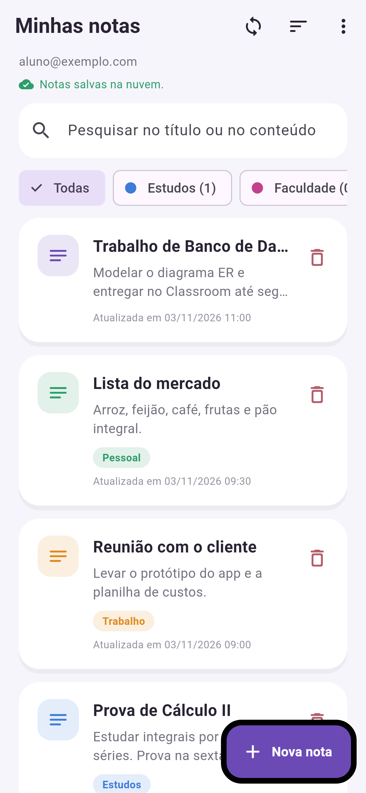
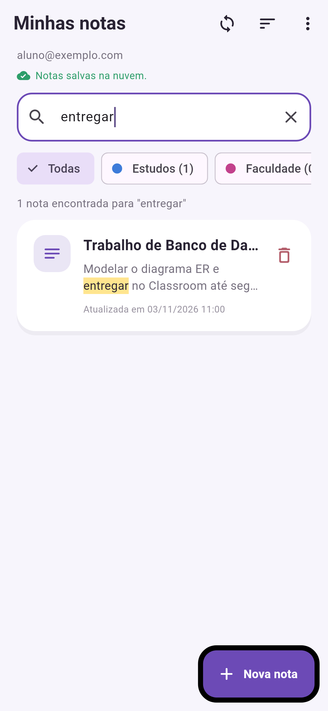
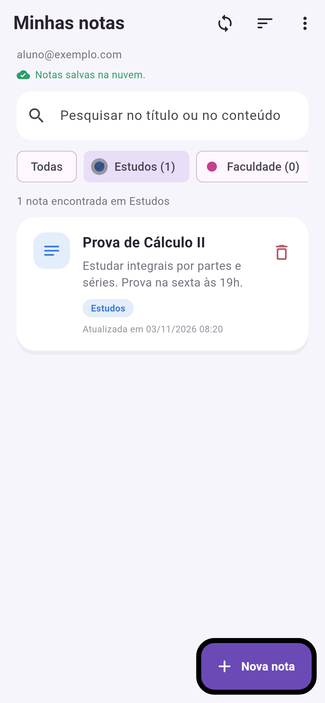
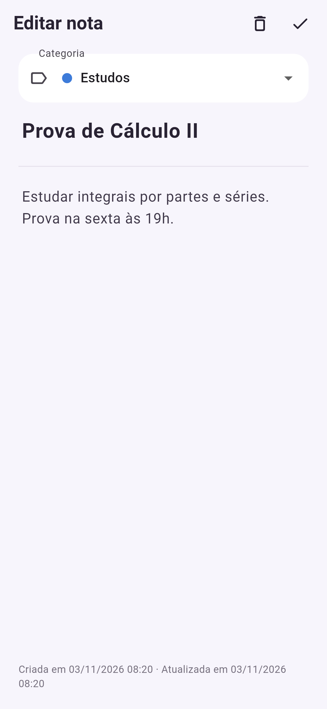
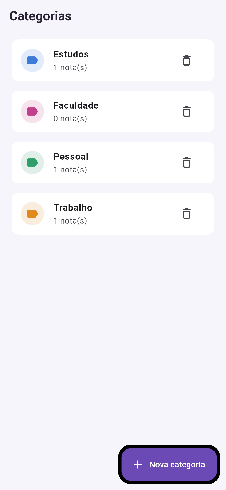
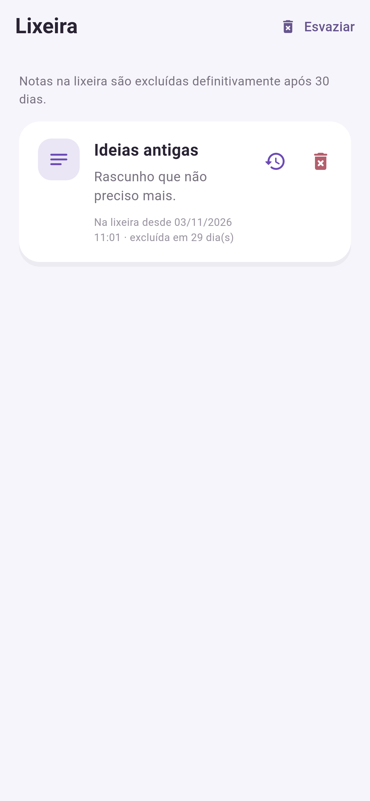
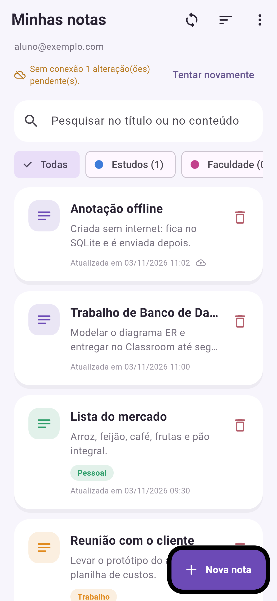

# Bloco de Notas — SQLite + Cloud Firestore

Aplicativo Flutter de bloco de notas com **armazenamento local (SQLite)** e
**sincronização com o Firebase (Authentication + Cloud Firestore)**.
Evolução do projeto base da disciplina
([LopesBrendinha/bloco_de_nota_turma_A](https://github.com/LopesBrendinha/bloco_de_nota_turma_A)).

**Objetivo:** permitir que cada usuário crie, organize, pesquise e recupere
suas notas em qualquer instalação do app, funcionando também sem internet,
sem que um usuário consiga ver ou alterar as notas de outro.

---

## Sumário

1. [Funcionalidades](#1-funcionalidades)
2. [Tecnologias e dependências](#2-tecnologias-e-dependências)
3. [Instalação e execução](#3-instalação-e-execução)
4. [Configurar o Firebase](#4-configurar-o-firebase)
5. [Arquitetura e organização dos arquivos](#5-arquitetura-e-organização-dos-arquivos)
6. [Padrões de projeto](#6-padrões-de-projeto)
7. [Armazenamento local e integração com o Firebase](#7-armazenamento-local-e-integração-com-o-firebase)
8. [Estratégia de sincronização e tratamento de erros](#8-estratégia-de-sincronização-e-tratamento-de-erros)
9. [Autenticação e segurança dos dados](#9-autenticação-e-segurança-dos-dados)
10. [Testes](#10-testes)
11. [Capturas de tela](#11-capturas-de-tela)
12. [O que mudou em relação ao projeto base](#12-o-que-mudou-em-relação-ao-projeto-base)

---

## 1. Funcionalidades

### Notas (SQLite + Firestore)
- Cadastrar, consultar, editar e excluir notas. Toda operação é gravada no
  SQLite e enviada ao Firestore.
- Cada nota pertence ao usuário autenticado (`uid`) e fica em
  `users/{uid}/notes/{id}` no Firestore.
- Ao entrar novamente ou em **outra instalação**, as notas da nuvem são
  baixadas para o SQLite.
- Funciona **offline**: as alterações ficam pendentes no aparelho e são
  enviadas quando a conexão volta. A tela mostra o estado ("Notas salvas na
  nuvem", "Sem conexão… N alterações pendentes", botão "Tentar novamente").
  Cada nota ainda não enviada mostra um ícone de nuvem.

### Categorias e pesquisa
- Categorias padrão **Estudos**, **Trabalho** e **Pessoal**, e criação de
  categorias do usuário (nome + cor), direto no formulário da nota
  ("Nova categoria…") ou na tela **Categorias**.
- Cada nota tem uma categoria (ou "Sem categoria"). Excluir uma categoria
  não apaga as notas: elas ficam sem categoria.
- Filtro por categoria (chips na tela principal, com contagem de notas).
- **Pesquisa por título ou conteúdo**, sem diferenciar maiúsculas nem
  acentos ("reuniao" encontra "Reunião"). Com várias palavras, todas
  precisam aparecer. A pesquisa pode ser combinada com o filtro de
  categoria. Os termos encontrados ficam **destacados** no resultado, e é
  exibido o total ("3 notas encontradas para …").

### Funcionalidades adicionais
- **Lixeira com recuperação:** excluir uma nota a move para a lixeira
  (com opção "Desfazer"). Na lixeira é possível **restaurar**, **excluir
  definitivamente** ou **esvaziar**. Notas com mais de 30 dias na lixeira
  são excluídas automaticamente ao abrir o app. O estado da lixeira também
  é sincronizado com o Firestore.
- **Ordenação por data:** última atualização (recentes/antigas), data de
  criação (recentes/antigas) ou título (A–Z). O card mostra a data
  correspondente à ordenação escolhida.

### Conta
- Cadastro e login com e-mail/senha (Firebase Authentication), com
  mensagens de erro em português. A sessão é mantida ao reabrir o app.
- Ao sair com alterações não enviadas, o app avisa antes.

---

## 2. Tecnologias e dependências

| Tecnologia | Uso |
|---|---|
| Flutter / Dart (SDK `^3.12.2`) | Interface e lógica |
| [`sqflite`](https://pub.dev/packages/sqflite) + [`path`](https://pub.dev/packages/path) | Banco local SQLite |
| [`firebase_core`](https://pub.dev/packages/firebase_core) | Inicialização do Firebase |
| [`firebase_auth`](https://pub.dev/packages/firebase_auth) | Login com e-mail e senha |
| [`cloud_firestore`](https://pub.dev/packages/cloud_firestore) | Armazenamento em nuvem |
| [`uuid`](https://pub.dev/packages/uuid) | IDs únicos gerados no aparelho |
| `flutter_test` + [`sqflite_common_ffi`](https://pub.dev/packages/sqflite_common_ffi) (dev) | Testes com SQLite real no computador |
| Node.js + `firebase-tools` + `@firebase/rules-unit-testing` (dev, pasta `firestore_tests/`) | Testes das regras de segurança no emulador |

As versões exatas estão em `pubspec.yaml` / `pubspec.lock` e
`firestore_tests/package.json`.

---

## 3. Instalação e execução

Pré-requisitos: Flutter SDK (stable), Android Studio ou Xcode com
emulador/dispositivo, Node.js (para o Firebase CLI).

```bash
# 1. Entrar na pasta do app
cd bloco_de_notas

# 2. Instalar dependências
flutter pub get

# 3. Configurar o Firebase (seção 4) — gera lib/firebase_options.dart
#    e android/app/google-services.json
flutterfire configure

# 4. Publicar as regras de segurança do Firestore
firebase deploy --only firestore:rules

# 5. Executar
flutter run
```

> Sem o passo 3 o app abre uma tela "Firebase não configurado" em vez de
> travar, e o build Android falha por falta do `google-services.json`.

---

## 4. Configurar o Firebase

Os arquivos de configuração do Firebase **não estão no repositório**
(veja a seção 9). Cada pessoa gera os do seu próprio projeto:

1. Crie um projeto em <https://console.firebase.google.com>.
2. **Authentication → Método de login →** ative **E-mail/senha**.
3. **Firestore Database → Criar banco de dados** (modo produção; escolha a
   região, ex.: `southamerica-east1`).
4. Instale as ferramentas (uma vez):
   ```bash
   npm install -g firebase-tools
   firebase login
   dart pub global activate flutterfire_cli
   ```
5. Na pasta `bloco_de_notas`, rode `flutterfire configure`, escolha o projeto
   e as plataformas. Ele cria/atualiza:
   - `lib/firebase_options.dart` (substitui o arquivo de exemplo);
   - `android/app/google-services.json`;
   - `ios/Runner/GoogleService-Info.plist` (se escolher iOS).
6. Evite fazer commit da sua configuração:
   ```bash
   git update-index --skip-worktree lib/firebase_options.dart
   ```
   (`google-services.json` e `GoogleService-Info.plist` já estão no
   `.gitignore`.)
7. Publique as regras: copie `.firebaserc.example` para `.firebaserc`,
   coloque o ID do projeto e rode `firebase deploy --only firestore:rules`
   (ou cole o conteúdo de `firestore.rules` em **Firestore → Regras** no
   console).

---

## 5. Arquitetura e organização dos arquivos

O app usa **camadas**. Cada camada só conhece a camada de baixo:

```
 Páginas (pages/, widgets/)          ← interface, sem SQL nem Firebase
        │  chamam métodos / escutam mudanças
        ▼
 NotesController (controllers/)      ← estado da tela (ChangeNotifier)
        │
        ├──────────────► NoteRepository (repositories/)  ← regras + escrita local
        │                        │
        └──────────────► SyncService (services/)         ← SQLite ⇄ Firestore
                                 │                │
                                 ▼                ▼
                   Data sources locais     RemoteDataSource (abstrato)
                   (data/local/, SQLite)   └─ FirestoreRemoteDataSource
```

```
bloco_de_notas/
├── lib/
│   ├── main.dart                     Inicializa o Firebase e o app
│   ├── app.dart                      Tema, AuthGate e montagem das dependências
│   ├── firebase_options.dart         EXEMPLO — gerado por `flutterfire configure`
│   ├── core/text_utils.dart          Normalização (sem acento) e formatação de datas
│   ├── models/
│   │   ├── note.dart                 Nota + conversão SQLite/Firestore
│   │   ├── category.dart             NoteCategory + categorias padrão
│   │   ├── note_sort.dart            Ordenações disponíveis
│   │   └── sync_status.dart          synced / pendingUpsert / pendingDelete
│   ├── data/
│   │   ├── local/
│   │   │   ├── app_database.dart     Conexão SQLite, schema e migração v1→v2
│   │   │   ├── note_local_data_source.dart      SQL da tabela notes (pesquisa, filtros)
│   │   │   └── category_local_data_source.dart  SQL da tabela categories
│   │   └── remote/
│   │       ├── remote_data_source.dart          Contrato da nuvem + RemoteException
│   │       └── firestore_remote_data_source.dart Implementação com Firestore
│   ├── repositories/note_repository.dart  CRUD, lixeira, categorias, validação
│   ├── services/
│   │   ├── auth_service.dart         Firebase Auth + mensagens de erro
│   │   └── sync_service.dart         Envio, recebimento e resolução de conflitos
│   ├── controllers/notes_controller.dart  Estado da tela, pesquisa, filtros, sync
│   ├── pages/                        login, register, notes, note_form, categories, trash
│   └── widgets/                      note_card, highlighted_text, sync_status_bar,
│                                     category_dialog, feedback
├── test/                             Testes de unidade, integração (SQLite) e interface
├── test_screenshots/                 Gera as imagens de docs/screenshots
├── firestore.rules                   Regras de segurança do Firestore
├── firestore_tests/                  Testes das regras no emulador (Node)
├── firebase.json                     Aponta para firestore.rules
└── .firebaserc.example               Modelo para o ID do projeto
```

---

## 6. Padrões de projeto

| Padrão | Onde | Por quê |
|---|---|---|
| **Singleton** | `AppDatabase.instance` (`data/local/app_database.dart`) | Uma única conexão SQLite aberta e reaproveitada pelo app inteiro. O construtor público com `path` permite criar bancos separados nos testes. |
| **DAO / Data Source** | `NoteLocalDataSource`, `CategoryLocalDataSource`, `FirestoreRemoteDataSource` | Todo o SQL e todo o acesso ao Firestore ficam isolados nessas classes; nenhuma tela escreve SQL ou acessa coleções. |
| **Repository** | `NoteRepository` | Ponto único para as regras de negócio (validação, lixeira, categorias padrão, nomes duplicados). Implementa a estratégia *offline-first*: grava no SQLite e marca como pendente. |
| **Inversão de dependência (interface)** | `RemoteDataSource` (abstrato) usado por `SyncService` | A sincronização não depende do Firestore diretamente. Nos testes ela roda com `FakeRemoteDataSource` (nuvem em memória), o que permitiu testar offline, conflitos e acesso negado. |
| **Observer** | `NotesController extends ChangeNotifier` + `ListenableBuilder` nas páginas | Quando os dados mudam (gravação, pesquisa, sincronização), o controller chama `notifyListeners()` e as telas se redesenham sozinhas. |
| **Injeção de dependência (manual, por construtor)** | `NotesHome` em `app.dart` monta `AppDatabase → DataSources → Repository/SyncService → Controller` | As classes recebem suas dependências em vez de criá-las, o que facilita trocar implementações e testar. |
| **Factory constructor / Mapper** | `Note.fromMap`, `Note.fromFirestore`, `toMap`, `toFirestore` (idem `NoteCategory`) | Conversão entre o objeto Dart e os formatos do SQLite (snake_case, com `sync_status` e `search_index`) e do Firestore (camelCase, sem campos locais). |

---

## 7. Armazenamento local e integração com o Firebase

### SQLite (fonte de dados da interface)
Arquivo `notes.db`, versão de schema **2**:

```sql
notes(id TEXT PK,           -- UUID, igual ao ID do documento no Firestore
      uid TEXT,             -- dono da nota
      title, content TEXT,
      category_id TEXT,     -- NULL = sem categoria
      created_at, updated_at INTEGER,   -- milissegundos
      deleted_at INTEGER,   -- NULL = ativa; preenchido = na lixeira
      sync_status TEXT,     -- synced | pendingUpsert | pendingDelete
      search_index TEXT)    -- título + conteúdo, minúsculo e sem acento

categories(id, uid, name, color, updated_at, sync_status, PK(uid, id))
```

- Todas as consultas filtram por `uid`, então dois usuários no mesmo
  aparelho não veem as notas um do outro.
- **Pesquisa:** cada termo vira um `search_index LIKE '%termo%'` (com `%` e
  `_` escapados) combinado com `AND`, além dos filtros de categoria e
  lixeira e do `ORDER BY` escolhido. Como os dados da nuvem são baixados
  para o SQLite, a pesquisa funciona igual para notas criadas no aparelho,
  vindas de outra instalação ou feitas offline.
- **Migração:** o schema v1 do projeto base (`id INTEGER`, `date TEXT`) é
  convertido em `onUpgrade`: as notas antigas recebem UUID e ficam
  pendentes de envio.

### Cloud Firestore (cópia na nuvem)
```
users/{uid}/notes/{noteId}
    uid, title, content, categoryId, createdAt, updatedAt, deletedAt,
    serverUpdatedAt (timestamp do servidor)
users/{uid}/categories/{categoryId}
    uid, name, color, updatedAt, serverUpdatedAt
```
O cache offline próprio do Firestore é **desativado** (`persistenceEnabled:
false` em `main.dart`): o SQLite é o único armazenamento offline e a
comunicação entre os dois é feita explicitamente pelo `SyncService`, sem
duas filas de pendências concorrentes.

---

## 8. Estratégia de sincronização e tratamento de erros

**Offline-first:** a interface lê e grava somente no SQLite. Toda escrita
marca o registro como pendente e dispara uma sincronização em segundo
plano (a tela não espera a rede).

### Quando sincroniza
- ao abrir a tela de notas (login ou app reaberto);
- depois de qualquer alteração (criar, editar, lixeira, categorias);
- manualmente: botão de sincronizar, "puxar para atualizar" ou "Tentar
  novamente".

Se uma alteração acontece durante uma sincronização, outra rodada é feita
ao final.

### Etapas (`services/sync_service.dart`)
1. **Envio (push)** — categorias primeiro, depois notas:
   - `pendingUpsert` → grava em `users/{uid}/notes/{id}` e marca `synced`
     (só se a nota não foi alterada durante o envio — `updated_at` é
     conferido no `UPDATE`);
   - `pendingDelete` → apaga no Firestore e só então apaga do SQLite.
   - O envio de nota usa uma **transação**: se a nuvem já tiver uma versão
     com `updatedAt` maior (editada em outro aparelho), a versão local mais
     antiga **não** sobrescreve a da nuvem.
2. **Recebimento (pull)** — lê todos os documentos do usuário e compara com
   o SQLite:

   | Situação | Resultado |
   |---|---|
   | Documento não existe no aparelho | inserido no SQLite |
   | Local `synced` e `updatedAt` diferente | versão da nuvem substitui a local |
   | Local pendente | vence o maior `updatedAt` (*last write wins*) |
   | Local `pendingDelete` | mantido (a exclusão ainda será enviada) |
   | Local `synced` que não existe mais na nuvem | foi excluído em outro aparelho → removido do SQLite |

Como o ID é um UUID gerado no aparelho, reenviar a mesma nota (por exemplo,
após um tempo esgotado) sobrescreve o mesmo documento: **não há
duplicação**. As categorias padrão usam IDs fixos (`default-estudos` etc.)
pelo mesmo motivo.

### Tratamento de erros
- `FirestoreRemoteDataSource` aplica **timeout de 10 s** e converte erros
  em `RemoteException`:
  - `unavailable`, `deadline-exceeded`, falha de rede, timeout →
    **offline**: "Sem conexão com o Firebase. As notas ficam salvas no
    aparelho.";
  - `permission-denied` / `unauthenticated` → **acesso negado** (regras);
  - outros códigos → mensagem com o código.
- Ao primeiro erro a rodada é interrompida; nada é perdido, pois os
  registros continuam pendentes no SQLite e são reenviados na próxima vez.
- A `SyncStatusBar` mostra o estado e o número de pendências, com botão
  **Tentar novamente**; cada nota não enviada exibe um ícone de nuvem.
- Erros de login/cadastro são traduzidos (`AuthService.messageFor`), e
  erros de validação (nota vazia, título > 200, categoria duplicada) são
  mostrados ao usuário.
- Sem `firebase_options.dart` configurado, o app exibe uma tela de
  orientação em vez de fechar.

---

## 9. Autenticação e segurança dos dados

- **Autenticação:** Firebase Authentication com e-mail e senha. O `AuthGate`
  escuta `authStateChanges()`: sem usuário mostra o login; com usuário cria
  o controller daquele `uid`. A sessão é mantida pelo Firebase.
- **Isolamento local:** todas as consultas SQLite usam `WHERE uid = ?`.
- **Regras do Firestore** (`firestore.rules`):
  - tudo negado por padrão (`match /{document=**}` → `false`);
  - em `users/{userId}/notes` e `users/{userId}/categories`, só lê/escreve
    quem tem `request.auth.uid == userId`;
  - o campo `uid` do documento precisa ser o do dono;
  - campos validados: somente os campos esperados (`hasOnly`), tipos,
    título ≤ 200, conteúdo ≤ 100.000, nome de categoria 1–40 caracteres,
    `serverUpdatedAt == request.time`.
- As regras são **testadas no emulador** (`firestore_tests/`): dono pode
  tudo; outro usuário e visitante não leem/alteram/excluem; `uid` falso e
  dados inválidos são recusados; caminhos fora de `users/{uid}` são
  bloqueados.
- **Segredos:** nenhum arquivo de configuração/credencial está versionado.
  `lib/firebase_options.dart` é apenas um exemplo sem chaves;
  `google-services.json`, `GoogleService-Info.plist`, `.firebaserc` e
  arquivos de conta de serviço estão no `.gitignore`. A configuração do
  Firebase para apps cliente identifica o projeto, mas a proteção real dos
  dados vem das regras acima — por isso elas são obrigatórias.

---

## 10. Testes

```bash
# Testes do app (unidade, integração com SQLite real e interface) — 31 testes
flutter test

# Regras de segurança no emulador do Firestore (requer Java e Node.js) — 7 testes
cd firestore_tests && npm install && npm test

# Regerar as capturas de tela da interface
flutter test test_screenshots --update-goldens
```

| Arquivo | O que verifica |
|---|---|
| `test/note_repository_test.dart` | CRUD, isolamento por usuário, pesquisa (título/conteúdo, acentos, várias palavras, `%`/`_`), categorias, ordenação, lixeira e expiração |
| `test/sync_service_test.dart` | Envio, falta de conexão e reenvio, recuperação em outra instalação, edição em outro aparelho, conflito (vence o mais recente), lixeira e exclusões sincronizadas, acesso negado, sem duplicação |
| `test/notes_page_test.dart` | Fluxo pela interface: criar nota com categoria, pesquisar e confirmar envio |
| `test/text_utils_test.dart` | Normalização, termos, datas e destaque |
| `firestore_tests/rules.test.mjs` | Regras de segurança |

Os testes de sincronização simulam o Firestore com `FakeRemoteDataSource`
(`test/helpers/fakes.dart`), e cada "aparelho" tem seu próprio arquivo
SQLite.

---

## 11. Capturas de tela

### Interface do app
Geradas por `test_screenshots/screenshots_test.dart`, renderizando as telas
reais com dados do SQLite (a nuvem é simulada nessas imagens; a sombra do
botão "Nova nota" aparece escura por limitação da renderização de testes).

| Login | Lista de notas | Pesquisa | Filtro por categoria |
|---|---|---|---|
|  |  |  |  |

| Editar nota | Categorias | Lixeira | Sem conexão |
|---|---|---|---|
|  |  |  |  |

### Evidências no Firebase
> **A fazer pelo aluno:** estas imagens dependem do seu projeto Firebase e
> devem ser capturadas com o app rodando no emulador/dispositivo. Salve-as
> em `docs/screenshots/firebase/` com os nomes abaixo.

| Evidência | Arquivo |
|---|---|
| Authentication → Usuários, com a conta de teste | `firebase/01_auth_usuarios.png` |
| Firestore → `users/{uid}/notes` com as notas criadas no app | `firebase/02_firestore_notas.png` |
| Documento de uma nota aberto (campos `title`, `categoryId`, `updatedAt`, `serverUpdatedAt`) | `firebase/03_firestore_documento.png` |
| `users/{uid}/categories` | `firebase/04_firestore_categorias.png` |
| Firestore → Regras publicadas | `firebase/05_regras.png` |
| App em outro emulador/instalação mostrando as mesmas notas após login | `firebase/06_outra_instalacao.png` |

<!-- Depois de adicionar as imagens, descomente:


-->

---

## 12. O que mudou em relação ao projeto base

| Arquivo / componente | Alteração |
|---|---|
| `lib/database/database_helper.dart` | Substituído por `data/local/app_database.dart` + data sources. Corrige o `CREATE TABLE` (vírgula sobrando), adiciona categorias, lixeira, controle de sincronização, índice de pesquisa e migração da v1. |
| `lib/models/note.dart` | ID UUID, `categoryId`, `createdAt`/`updatedAt` em ms, `deletedAt`, `syncStatus`; conversão SQLite e Firestore. |
| `lib/models/category.dart`, `note_sort.dart`, `sync_status.dart` | Novos. |
| `lib/services/auth_service.dart` | `authStateChanges`, mensagens de erro em português. |
| `lib/services/sync_service.dart`, `data/remote/*` | Novos: integração e sincronização com o Firestore. |
| `lib/repositories/`, `lib/controllers/` | Novos: regras de negócio e estado da tela. |
| `lib/main.dart`, `lib/app.dart` | `AuthGate` (sessão mantida), injeção de dependências, tela de configuração ausente, Firestore sem cache próprio. |
| `pages/notes_page.dart` | Pesquisa, filtro por categoria, ordenação, status de sincronização, menu (categorias, lixeira, sair), desfazer. |
| `pages/note_form_page.dart` | Seleção/criação de categoria, validação, mover para lixeira, datas. |
| `pages/categories_page.dart`, `pages/trash_page.dart` | Novos. |
| `widgets/*` | Card com categoria/destaque/pendência, barra de sync, diálogos. |
| `firestore.rules`, `firebase.json`, `firestore_tests/` | Regras de segurança e testes. |
| `android/app/google-services.json`, `lib/firebase_options.dart` (do projeto base) | Removidos do repositório; gerados localmente por `flutterfire configure`. |
| `pubspec.yaml` | `cloud_firestore`, `uuid`, `sqflite_common_ffi` (dev). |
